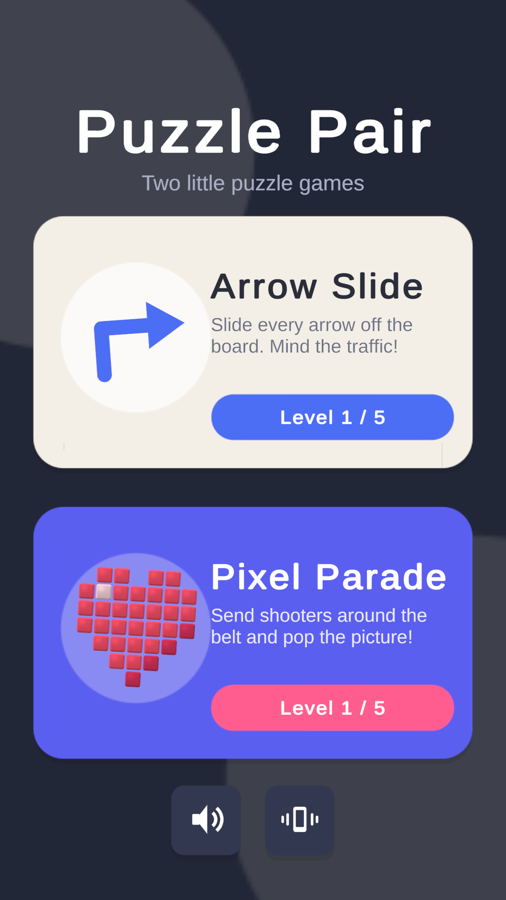
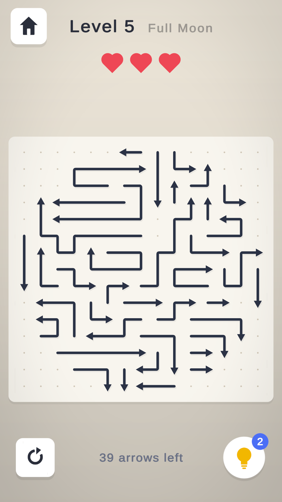
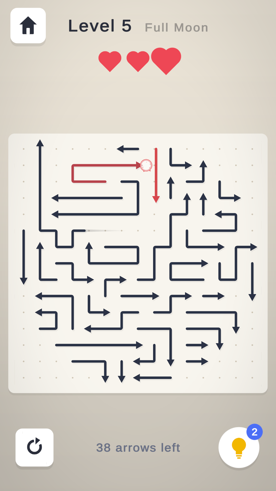
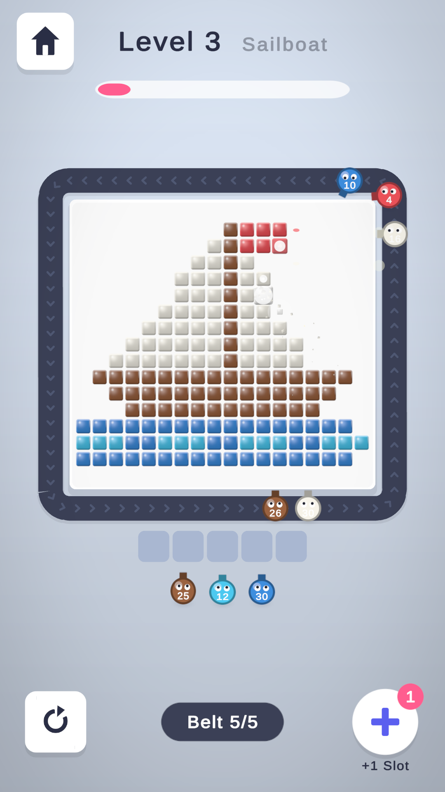
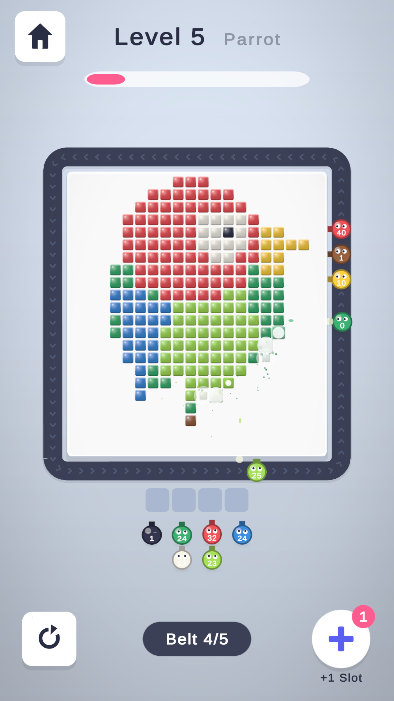
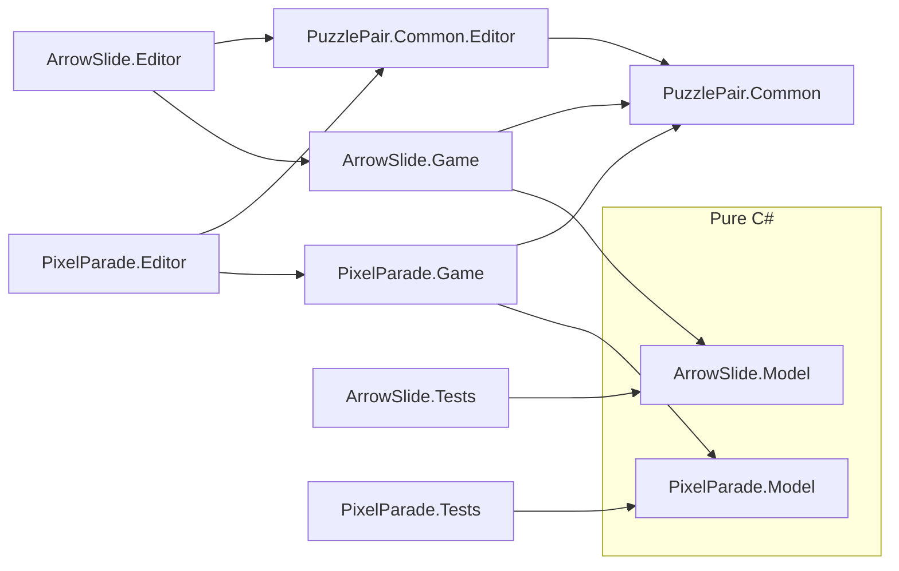

# Puzzle Pair

Two hyper-casual puzzle games in one Unity project, built as a portfolio piece:

| | **Arrow Slide** | **Pixel Parade** |
|---|---|---|
| Inspired by | *Arrows – Puzzle Escape* | *Pixel Flow!* (Loom Games) |
| Goal | Tap arrows so they slide off the board. An arrow that would hit another one bounces back and costs a heart. | Tap shooters so they ride a belt around a pixel picture and pop every pixel of their colour they can see. Don't run out of waiting slots. |
| Levels | 5 boards, from 3 to 39 arrows | 5 pictures, from 156 to 241 pixels |

The mechanics were re-implemented from scratch. **All names, art, sounds, levels and UI are original.** Every sprite is baked from signed distance functions and every sound is synthesized at runtime, so the repository contains no third-party assets. This project is not affiliated with the original games or their studios.

| Menu | Arrow Slide | Arrow Slide (moves) | Pixel Parade | Pixel Parade |
|:---:|:---:|:---:|:---:|:---:|
|  |  |  |  |  |

*Screenshots are rendered by the PlayMode test suite itself (see [Recording media](#recording-media)).*

> More of my projects: **[burak-unye.vercel.app](https://burak-unye.vercel.app)**

---

## Highlights

- **Engine-free game models.** Both rule sets live in `noEngineReferences` assemblies (`ArrowSlide.Model`, `PixelParade.Model`). They are deterministic, have no `UnityEngine` dependency and are covered by **51 EditMode tests** that also run with plain `dotnet test`.
- **End-to-end PlayMode smoke tests** load the generated scenes and play real levels through the same entry points as touch input (win, lose, booster, menu navigation). Any exception or error log fails the run.
- **Levels are text you can review in a diff.** Boards and pictures are written as ASCII in C#; tests prove every level parses, is solvable and gets harder. There is no runtime level generator.
- **Proof of solvability, not just a check.** Arrow Slide's solver is *complete* by a monotonicity argument (below). Pixel Parade levels are played to the end by a greedy bot on the real simulation, and the test asserts the bot never needs the last slot.
- **Fixed-step simulation, smooth presentation.** Pixel Parade ticks at a fixed rate; the view interpolates riders between belt nodes and replays simulation events (shot, spent, slotted…) as animation.
- **Zero manual scene setup.** `Tools > Puzzle Pair > Build All Scenes` generates the main menu and both game scenes, the theme assets, sprites, materials, player settings and build list. Builders are discovered through `TypeCache`, so adding a game is one class.
- **Game feel:** snake-like arrow motion with anticipation and acceleration, bump-and-spring-back on a blocked move, hearts that crack, screen shake, pixel pops with debris and rising pitch, shooters that squash, stretch, recoil and look where they aim, confetti, haptics, procedural sound.

## Getting started

1. Open the folder with **Unity 6000.0.58f2** (URP 2D, Input System).
2. Run **Tools > Puzzle Pair > Build All Scenes**.
3. Open `Assets/_Project/Scenes/MainMenu.unity` and press **Play** (Game view in a portrait resolution such as 1080×1920).

Tests: **Window > General > Test Runner** → *EditMode* (rules, levels, solver, bot) and *PlayMode* (scene smoke tests; build the scenes first).
Other tools: *Reset Progress*, *Start Every Game At Last Level*, *Capture Screenshot (F12, Play Mode)*, *Rebake Sprites*.

## Project structure

```
Assets/_Project
├── Common/                      shared by both games (asmdef PuzzlePair.Common)
│   ├── Runtime/  Audio (procedural Sfx), Feedback (Haptics, CameraRig), Fx (FxPool, TapPrompt),
│   │             Input (PointerInput), UI (panels, buttons, ScreenFader, TopBar), MainMenu, Progress
│   └── Editor/   SpriteBaker, SceneKit, UiKit, MainMenuBuilder, ProjectSetup, DevTools
├── Games/
│   ├── ArrowSlide/   Model (pure C#) · Runtime (views, flow) · Editor (scene builder) · Tests
│   └── PixelParade/  Model (pure C#) · Runtime (views, flow) · Editor (scene builder) · Tests
├── Tests/PlayMode/   smoke tests + screenshot renderer
└── Scenes/           generated: MainMenu, ArrowSlide, PixelParade
```



Common never references a game. The main menu learns about games through the `IGameEntry` interface that each game's scene builder implements.

## Arrow Slide

### Rules
Each arrow is a bent line of cells with a head. Tapping it moves it like a snake: the head travels straight in its heading and the body follows its own path. If the straight run in front of the head reaches the board edge without meeting another arrow, the arrow slides out. Otherwise it runs into the obstacle, bounces back and the player loses one of three hearts. Clear the board to win.

### The move check
`ArrowBoard.Check` walks the ray in front of the head. Another arrow on the ray blocks it. The arrow's *own* body needs care: body cell `i` (tail = 0) is vacated after `i + 1` steps, while the head reaches the `s`-th ray cell after `s` steps, so the arrow blocks itself only when `i ≥ s`. That is why a head may follow its own tail around a loop but cannot run into its own middle (both cases are tested).

### Why the greedy solver is complete
Removing an arrow only ever frees cells, so an arrow that can escape now can still escape after any other removal. Repeatedly removing every free arrow therefore clears the board **if and only if** it is solvable; the only way to be stuck is a blocking cycle. `ArrowSolver.Analyze` also reports the number of *waves* (rounds of simultaneous removals), a good proxy for how far ahead a player must look. The hint picks the free arrow whose removal frees the most others.

### Level format
```
"...U",      .  empty
">>R^",      > < ^ v  body, pointing towards the next cell of the same arrow
"...^",      R L U D  head and its heading
"L<<.",
```
The parser rebuilds every arrow by walking backwards from its head and rejects stray bodies, loops, forks and heads that don't point along their last segment.

Boards 1–2 were drawn by hand. The dense boards 3–5 were drafted with a small offline script (it places arrows in reverse removal order, each one's ray clear of everything placed before it, so every draft is solvable by construction) and then picked by hand; only the resulting text is in the project.

| # | Board | Arrows | Waves | Free at start |
|---|---|---|---|---|
| 1 | 4×4 | 3 | 2 | 2 |
| 2 | 5×6 | 10 | 4 | 3 |
| 3 | 8×10 | 21 | 6 | 5 |
| 4 | Heart 11×10 | 22 | 6 | 9 |
| 5 | Round 15×15 | 39 | 7 | 14 |

### Presentation
`ArrowView` draws an arrow with two `LineRenderer`s (body + soft shadow) and an arrowhead sprite. Every arrow lives on a *trail*: its cells followed by a straight run in its heading. One number, the offset along that trail, drives the intro (the body draws itself from the tail), the escape (short anticipation, then acceleration) and the bump (run into the blocker, jolt it, spring back with overshoot).

## Pixel Parade

### Rules
Shooters wait in lanes under the picture. Tap the front one and it boards the belt at the bottom-left corner, then rides counter-clockwise around the picture (right along the bottom, up, left along the top, down). At every row and column it passes, it looks inwards at the **first** pixel it can see; if that pixel has its colour it shoots it. A shooter disappears when its ammo runs out. If it completes a lap with ammo left it parks in a waiting slot and can be launched again. When a shooter comes back and every slot is taken, the level is lost. The belt carries at most five shooters at a time. A *+1 Slot* booster is available once per level.

### Simulation tick (`PixelSim.Tick`)
1. Every rider moves one node.
2. Riders back at the entry finish their lap: into the first free slot, or `Overflow` → lost.
3. Riders fire in boarding order at the first visible pixel of their row/column (colour must match).
4. One pending shooter boards if no rider is within `EntrySpacing` nodes of the entry.

The belt has one node per row and column plus four corners (`2W + 2H + 4` nodes). Ammo per colour equals the pixel count of that colour (validated by `PixelLevel.Validate`), so a level can only be lost through slots, never through missing ammo. The simulation emits `SimEvent`s; the view never inspects rules, it only replays events. Shots fire a projectile and the pixel pops when it lands, so model and view stay decoupled in time as well.

### Level format
```csharp
new PixelLevel("Strawberry", tip,
    new[] { ".......GG.......", ..., "......RRRR......" },  // picture, colour keys
    new[] { "R40 Y13 R39", "G38 R40" })                     // lanes, front first
```
Difficulty comes from lane order: a front shooter whose colour is buried wastes a lap and a slot.

| # | Picture | Pixels | Colours | Lanes | Slots | Bot: laps back to a slot / peak slots |
|---|---|---|---|---|---|---|
| 1 | Lime 14×14 | 156 | 2 | 2 | 5 | 3 / 1 |
| 2 | Strawberry 16×18 | 170 | 3 | 2 | 5 | 6 / 1 |
| 3 | Sailboat 18×17 | 182 | 5 | 3 | 5 | 8 / 2 |
| 4 | Cat 18×18 | 228 | 5 | 3 | 5 | 11 / 2 |
| 5 | Parrot 20×22 | 241 | 8 | 4 | 4 | 14 / 2 |

Pictures were drawn with simple shapes in a small offline script and the lanes were ordered by hand.

## Game feel

| Event | Feedback |
|---|---|
| Arrow escapes | anticipation pull-back, accelerating slide with a fading speed trail, speed lines + ring + dust where it leaves the board, whoosh with rising pitch on quick combos, light haptic |
| Arrow blocked | runs into the blocker, blocker jolts, both flash red, impact flash and sparks, the heart cracks and sheds pieces, screen shake, medium haptic |
| Hint | arrow pulses blue inside a breathing glow, shockwave ring |
| Shooter launched | squash, take-off dust, arc jump with stretch, landing puff, boards with a smooth blend into the belt motion |
| Shot | barrel turns to the target, muzzle flash, recoil, eyes follow the aim, ammo label punches, bullet flight |
| Pixel pop | flash, swell, spinning cube debris in the pixel's colour, sparkles on chains; flash, debris and pitch grow with the combo |
| Idle | shooters breathe and blink; a light sweep glides over the glossy picture every few seconds |
| Slots almost full | pads pulse red, warning sound, haptic |
| Win | confetti fountains, sparkles over the board, board bounce, camera zoom punch, fanfare, success haptic, result card with spinning light rays |

Lighting is faked with baked sprites: a top-lit `Backdrop` gradient and vignette that follow the camera, glossy pixel blocks (a tinted bevel plus a white gloss layer, since tinting can only darken), and the periodic light sweep.

Shared systems: `FxPool` (one fixed array of sprite particles with bursts, cube debris, sparkles, speed streaks and confetti, swap-back removal, no allocation after `Awake`), `Sfx` (round-robin voices, throttled repeats, clips synthesized once by `ProceduralAudio`), `Haptics` (Android `VibrationEffect` with amplitude), `CameraRig` (fits the level between the HUD bars on any aspect ratio and safe area, trauma-based shake), `ScreenFader` (scene transitions).

## Recording media

- **Automatic:** set the environment variable `PUZZLEPAIR_SHOTS` to a folder and run the PlayMode tests. `Screenshots.CaptureEveryScene` plays through the menu and both games and renders 1080×1920 PNGs (it is skipped when the variable is not set). Batch mode works too:
  `Unity -batchmode -projectPath . -runTests -testPlatform PlayMode`
- **Manual:** in Play Mode press **F12** (*Tools > Puzzle Pair > Capture Screenshot*) to save the Game view to `docs/media/`. Record GIFs of the Game view with any screen recorder.

## License and credits

Code: MIT. Gameplay inspired by *Arrows – Puzzle Escape* and *Pixel Flow!* (Loom Games); no assets, names or levels from those games are used. Font: LiberationSans (TextMeshPro Essentials, SIL OFL).
